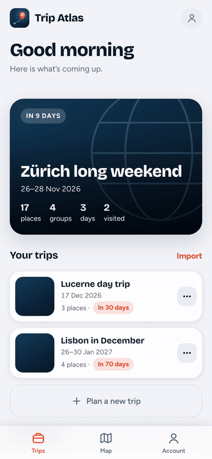
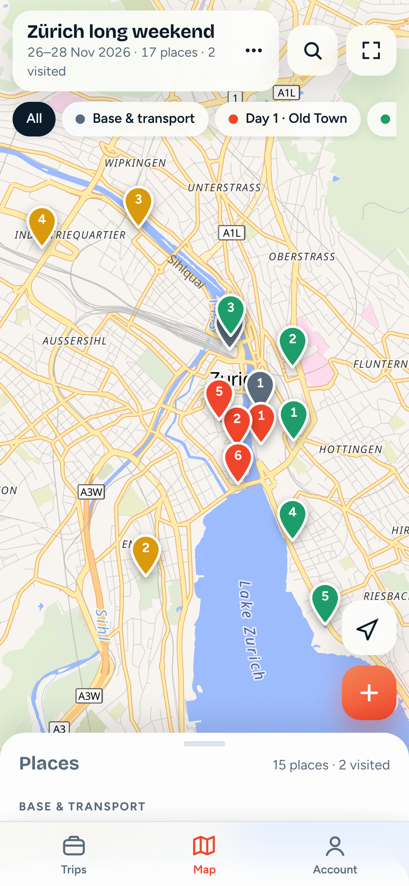
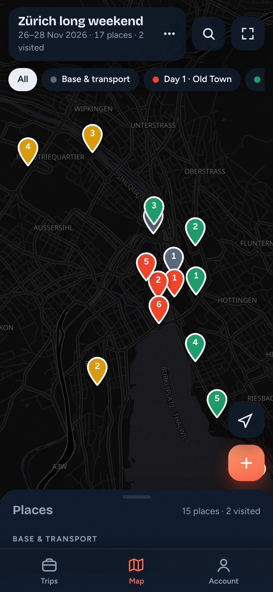
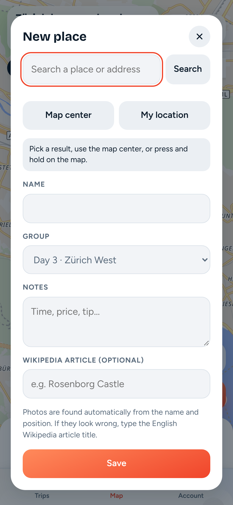
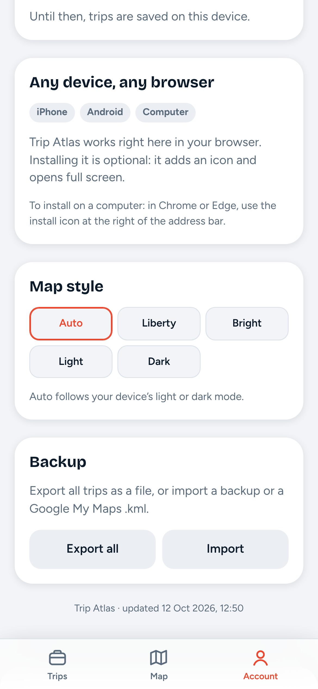
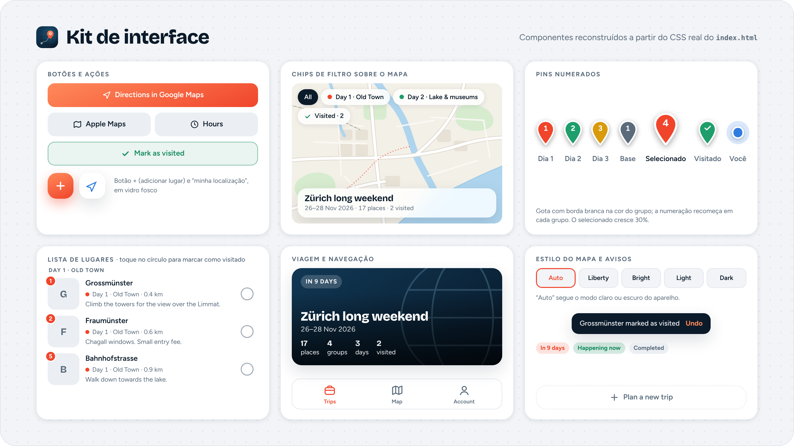

  <picture>
    <source media="(prefers-color-scheme: dark)" srcset="docs/readme/banner-dark.png">
    
  </picture>

  <a href="https://lucas-ayub.github.io/travel-guide-app/"><b>▶ Abrir o app</b></a>
  &nbsp;·&nbsp; <a href="#-o-app-em-ação">Em ação</a>
  &nbsp;·&nbsp; <a href="#-recursos">Recursos</a>
  &nbsp;·&nbsp; <a href="#-onde-funciona-e-como-instalar">Onde funciona</a>
  &nbsp;·&nbsp; <a href="#-identidade-visual">Identidade visual</a>
  &nbsp;·&nbsp; <a href="#️-como-funciona-por-dentro">Por dentro</a>

  
  
  
  
  

  
  
  

O **Trip Atlas** é um app de viagem em forma de mapa. Suas viagens são a tela inicial; dentro de cada uma, os lugares ficam num mapa vetorial como **pins numerados e coloridos por dia, cidade ou categoria**, cada um com **fotos encontradas automaticamente**, notas, resumo da Wikipédia, rotas no Google Maps ou Apple Maps e a **distância até você ao vivo**. Com uma conta (opcional), as viagens sincronizam entre aparelhos e podem ser **compartilhadas** com quem vai junto.

> **Funciona em qualquer aparelho, direto no navegador — sem baixar nada da loja.** iPhone e iPad, celulares e tablets Android e computador (Windows, Mac, Linux, Chromebook). É só abrir **[lucas-ayub.github.io/travel-guide-app](https://lucas-ayub.github.io/travel-guide-app/)**. Se quiser, dá para instalar como app, com ícone próprio e tela cheia ([veja como](#-onde-funciona-e-como-instalar)).

  

## 🎬 O app em ação

<table>
  <tr>
    <td align="center" width="33%"> <b>Explorar</b> — da viagem ao lugar</td>
    <td align="center" width="33%"> <b>Visitado</b> — um toque e ele sai do mapa</td>
    <td align="center" width="33%"> <b>Busca</b> — sem se preocupar com acentos</td>
  </tr>
</table>

Versões em vídeo (MP4): <a href="docs/readme/demo-browse.mp4">explorar</a> · <a href="docs/readme/demo-visited.mp4">visitado</a> · <a href="docs/readme/demo-search.mp4">busca</a>

## ✨ Recursos

<picture>
  <source media="(prefers-color-scheme: dark)" srcset="docs/readme/features-dark.png">
  
</picture>

- **🧳 Viagens na tela inicial** — a viagem atual ou a próxima aparece num cartão grande com foto de capa, contagem regressiva ("in 9 days") e números (lugares, grupos, dias, visitados); depois vêm as outras viagens e as que já passaram.
- **🗺️ Mapa com pins por grupo** — [MapLibre GL](https://maplibre.org) com estilos do [OpenFreeMap](https://openfreemap.org) (Auto, Liberty, Bright, Light, Dark). Cada grupo (um dia, uma cidade, uma categoria) tem uma cor; os **chips** no topo filtram por grupo e a **lista** embaixo mostra os mesmos lugares com foto, nota e distância.
- **📍 Adicionar lugares** — buscando nome ou endereço ([Photon](https://photon.komoot.io)), usando o centro do mapa ou a sua localização, ou **segurando o dedo no mapa** (clique direito no computador). Cada lugar tem grupo, notas e, se quiser, o título do artigo na Wikipédia em inglês, que ajuda a achar as fotos certas.
- **📸 Fotos automáticas, só de fontes abertas** — nesta ordem:
  1. fotos de viajantes no Flickr e no Wikimedia Commons, via [Openverse](https://openverse.org), buscando nome + cidade;
  2. a foto do Wikidata e as que a maioria das Wikipédias usa para o lugar;
  3. fotos de viajantes com os outros nomes do lugar (título na Wikipédia, nome no idioma local);
  4. a categoria do lugar no Wikimedia Commons;
  5. fotos tiradas no local cujo nome de arquivo cita o lugar;
  6. fotos dos arredores, marcadas como "Nearby".

  Mapas, desenhos, pinturas, fotos em preto e branco e de arquivo ficam de fora. No visualizador em tela cheia dá para escolher a **foto de capa** ou **esconder** uma foto.
- **🪧 Cartão do lugar** — fotos, notas, resumo da Wikipédia, **rotas no Google Maps** (transporte público) ou **Apple Maps** e horário de funcionamento.
- **🔎 Busca dentro da viagem** — enquanto você digita, procura em nomes, notas, grupos e títulos da Wikipédia, **ignorando acentos e maiúsculas** ("malmo" acha Malmö). Todas as palavras precisam bater, o trecho encontrado fica destacado e o mapa mostra só os pins correspondentes.
- **✅ Marcar como visitado** — o tique redondo na lista (ou *Mark as visited* no cartão) tira o lugar do mapa e da lista e o leva para o chip **Visited**, com dia e hora. Dá para desfazer na hora.
- **👥 Conta, sincronização e compartilhamento** — nome, e-mail e senha ([Supabase](https://supabase.com)). Suas viagens aparecem na hora ao abrir o app, **mesmo offline**, e sincronizam quando a conexão volta. Convide alguém por e-mail com **Can edit** ou **Can view**.
- **💾 Backup** — exporte uma viagem ou todas como JSON; importe um backup ou um **.kml do Google My Maps**.
- **🌗 Tema claro e escuro**, seguindo o sistema — inclusive o estilo do mapa no modo Auto.

## 📱 Onde funciona e como instalar

O Trip Atlas é um **app web (PWA)**: roda em qualquer navegador moderno. Usar direto no navegador já funciona; instalar é opcional e só deixa o app com ícone próprio, em tela cheia.

| Aparelho | Navegador | Usar | Instalar como app (opcional) |
|---|---|---|---|
| 📱 **iPhone / iPad** | Safari (ou Chrome, Edge…) | ✅ | Safari › botão **Compartilhar** › **Adicionar à Tela de Início**, e abra pelo ícone |
| 🤖 **Android** (celular e tablet) | Chrome, Edge, Samsung Internet, Firefox… | ✅ | Botão **Install Trip Atlas** na aba **Account**, ou Chrome › **⋮** › **Instalar app** (ou **Adicionar à tela inicial**) |
| 💻 **Computador** (Windows, Mac, Linux, Chromebook) | Chrome, Edge, Safari, Firefox… | ✅ | Chrome/Edge › ícone **Instalar** à direita da barra de endereço |

- **Primeira visita:** aparecem duas viagens de exemplo, *Demo trip · Paris* e *Demo trip · Rio de Janeiro*, para mostrar como tudo funciona. **Remove demos** na aba Trips apaga as duas; elas nunca vão para a sua conta.
- **Mesmas viagens em todos os aparelhos:** crie uma conta e entre com ela no celular e no computador. Sem conta, as viagens ficam salvas só no aparelho. *Keep me signed in* vem ligado; desligue num aparelho compartilhado.
- **No iPhone**, o app da Tela de Início e o Safari guardam logins separados.
- **Localização:** usa a localização do navegador (ele pede permissão) para mostrar onde você está e a distância até cada lugar.
- **Sem conexão:** suas viagens e sua conta continuam disponíveis, mas o mapa e as fotos precisam de internet.
- **No computador:** **Esc** fecha o visualizador de fotos, o cartão do lugar e a busca; **← →** passam as fotos; clique direito no mapa adiciona um lugar.
- **Botão Voltar** (Android e navegador) fecha primeiro a camada de cima: fotos, formulário, cartão, busca, lista, e por fim volta às viagens.
- **Atualizar:** feche o app por completo e abra de novo (o GitHub Pages pode levar uns 10 minutos para servir a versão nova). O fim da aba Account mostra a versão ("Trip Atlas · updated …").

## 🖼️ Telas

<table>
  <tr>
    <td width="25%"></td>
    <td width="25%"></td>
    <td width="25%"></td>
    <td width="25%"></td>
  </tr>
  <tr>
    <td align="center">Viagens (claro)</td>
    <td align="center">Viagens (escuro)</td>
    <td align="center">Mapa (claro)</td>
    <td align="center">Mapa (escuro)</td>
  </tr>
  <tr>
    <td width="25%"></td>
    <td width="25%"></td>
    <td width="25%"></td>
    <td width="25%"></td>
  </tr>
  <tr>
    <td align="center">Filtro por dia</td>
    <td align="center">Lista de lugares</td>
    <td align="center">Cartão do lugar</td>
    <td align="center">Busca</td>
  </tr>
  <tr>
    <td width="25%"></td>
    <td width="25%"></td>
    <td width="25%"></td>
    <td width="25%"></td>
  </tr>
  <tr>
    <td align="center">Visitados</td>
    <td align="center">Novo lugar</td>
    <td align="center">Configurações da viagem</td>
    <td align="center">Conta</td>
  </tr>
</table>

As capturas usam uma viagem fictícia a Zurique, sem conta. Elas foram geradas sem acesso aos serviços de fotos, por isso os lugares aparecem com a inicial colorida, que é como o app mostra um lugar ainda sem foto, e o cartão do lugar fica em "Loading photos…". No app de verdade, com internet, aparecem as fotos e o resumo da Wikipédia.

## 🎨 Identidade visual

O visual parte de um **atlas noturno**: azul-marinho profundo com a grade de um globo, uma rota pontilhada e um **pin coral** — o mesmo desenho do ícone. No app, o mapa ocupa a tela inteira e os controles flutuam por cima em **vidro fosco**; os lugares são **pins em gota, numerados e com contorno branco**, na cor do seu grupo. O coral marca as ações principais (adicionar, rotas), o verde só aparece para "visitado", e os cantos bem arredondados deixam tudo com cara de app nativo.

<picture>
  <source media="(prefers-color-scheme: dark)" srcset="docs/readme/palette-dark.png">
  
</picture>

<picture>
  <source media="(prefers-color-scheme: dark)" srcset="docs/readme/type-dark.png">
  
</picture>

<picture>
  <source media="(prefers-color-scheme: dark)" srcset="docs/readme/components-dark.png">
  
</picture>

## 🛠️ Como funciona por dentro

- **Um arquivo só:** `index.html` tem todo o app — HTML, CSS e JavaScript puro, sem framework e sem etapa de build. As bibliotecas vêm do jsDelivr: **MapLibre GL 4.7.1** e **supabase-js 2.49.4**.
- **Arquivos:**
  - `config.js` — URL do projeto Supabase e a chave pública (anon). Deixe os dois vazios para usar o app sem contas (as viagens ficam só no aparelho).
  - `setup.sql` — cria a tabela `trips` com segurança por linha (RLS): cada usuário só lê e escreve as próprias viagens.
  - `sharing.sql` — compartilhamento: tabela `trip_shares`, a função `trip_role()` (owner, editor ou viewer) e políticas em que o dono faz tudo, editores atualizam e quem só vê apenas lê; um gatilho impede que um editor vire dono.
  - `manifest.webmanifest`, `icon*.png`, `logo.svg` — nome, cores e ícones do app instalado (o ícone *maskable* se adapta aos formatos do Android).
  - `sw.js` — service worker que **não guarda cache**: existe só porque o Chrome exige um para oferecer a instalação, então cada abertura carrega a versão mais nova.
  - `PROMPTS.md` — a conversa que construiu o app.
- **Dados locais:** as viagens ficam no `localStorage` (`atlas.v2.guest` sem conta, `atlas.v2.<usuário>` com conta) e as fotos e resumos encontrados ficam num cache (`atlas.info.v6`). Com conta, as mudanças sobem para o Supabase e sincronizam quando há conexão.
- **Serviços externos, todos gratuitos:** OpenFreeMap (mapa), Photon da Komoot (busca de endereços e a cidade de cada lugar), Openverse (até 20 resultados por busca sem chave de API), APIs da Wikipédia, do Wikidata e do Wikimedia Commons (fotos e resumos) e links do Google Maps e Apple Maps para as rotas.
- **Detalhes de plataforma:** em apps da Tela de Início no iOS 26, a página pode terminar acima da borda de baixo; o app mede isso ao abrir e estende mapa, painéis e barra de abas até o fim (só no iPhone e iPad). No Android, os painéis usam unidades `dvh` para caber na área visível.

**Rodar localmente:** sirva a pasta com qualquer servidor estático, por exemplo `python3 -m http.server`, e abra `http://localhost:8000`.

**Configurar contas (opcional):** crie um projeto no Supabase, rode `setup.sql` e depois `sharing.sql` no SQL Editor, coloque a URL e a chave pública em `config.js` e, em Authentication, desligue *Confirm email* e defina Site URL e Redirect URLs com o endereço do app (para os links de troca de senha funcionarem).

## 🤖 Feito com IA (vibe-coded)

Este app foi construído descrevendo em linguagem natural o que eu queria para o **Claude**, o assistente de IA da Anthropic, que escreveu o código, o SQL, o logo e os passos de configuração. Eu testei principalmente no iPhone e guiei o desenvolvimento com feedback, mas não escrevi o código à mão. Pode haver arestas; revise o código antes de reaproveitar. A conversa completa, com os prompts e as respostas, está em [PROMPTS.md](PROMPTS.md).

## 🙏 Créditos

- Dados do mapa: © [colaboradores do OpenStreetMap](https://www.openstreetmap.org/copyright) (ODbL), com o esquema [OpenMapTiles](https://openmaptiles.org); mapas servidos pelo [OpenFreeMap](https://openfreemap.org).
- Mapa interativo: [MapLibre GL JS](https://maplibre.org) (licença BSD-3-Clause).
- Busca de endereços: [Photon](https://photon.komoot.io), da Komoot.
- Fotos: autores no Flickr e no Wikimedia Commons, sob licenças abertas, encontradas via [Openverse](https://openverse.org) e Wikimedia; cada foto mostra o crédito e o link para a original. Resumos da [Wikipédia](https://www.wikipedia.org) (CC BY-SA).
- Contas e banco de dados: [Supabase](https://supabase.com).
- Fontes: [Bricolage Grotesque](https://fonts.google.com/specimen/Bricolage+Grotesque) e [Figtree](https://fonts.google.com/specimen/Figtree) (SIL Open Font License).
- Feito por **Lucas Ayub**, com a ajuda do Claude (Anthropic).
