

  <picture>
    <source media="(prefers-color-scheme: dark)" srcset="docs/readme/banner-dark.png">
    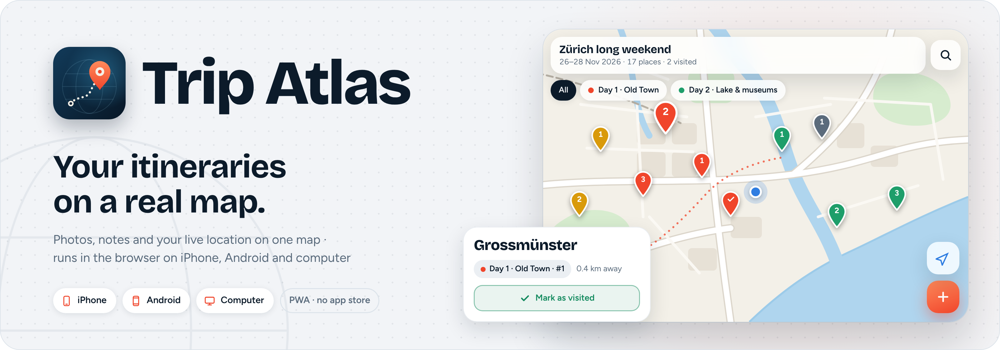
  </picture>

<b>🇺🇸 English</b> · <a href="README.pt-BR.md">🇧🇷 Português</a>

  <a href="https://lucas-ayub.github.io/travel-guide-app/"><b>▶ Open the app</b></a>
  &nbsp;·&nbsp; <a href="#-see-it-in-action">In action</a>
  &nbsp;·&nbsp; <a href="#-features">Features</a>
  &nbsp;·&nbsp; <a href="#-where-it-runs-and-how-to-install">Where it runs</a>
  &nbsp;·&nbsp; <a href="#-visual-identity">Visual identity</a>
  &nbsp;·&nbsp; <a href="#️-under-the-hood">Under the hood</a>

  
  
  
  
  

  
  
  

**Trip Atlas** is a travel app built around a map. Your trips are the home screen; inside each one, your places sit on a vector map as **numbered pins colored by day, city or category**, each with **photos found automatically**, notes, a Wikipedia summary, directions in Google Maps or Apple Maps and the **live distance from where you are**. With an (optional) account, trips sync across devices and can be **shared** with the people travelling with you.

> **Runs on any device, right in the browser — nothing to download from an app store.** iPhone and iPad, Android phones and tablets, and computers (Windows, Mac, Linux, Chromebook). Just open **[lucas-ayub.github.io/travel-guide-app](https://lucas-ayub.github.io/travel-guide-app/)**. If you like, install it as an app with its own icon, full screen ([see how](#-where-it-runs-and-how-to-install)).

  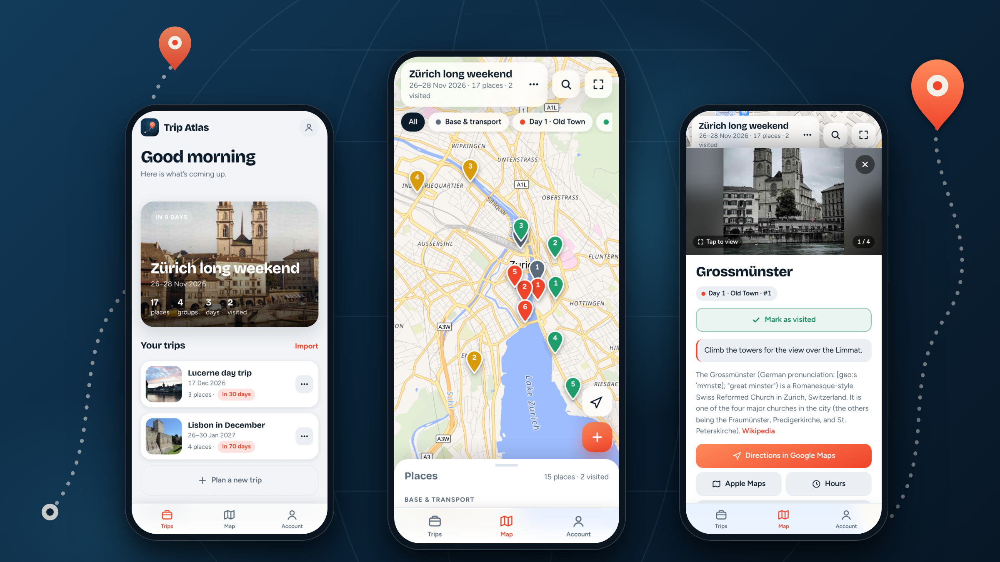

## 🎬 See it in action

<table>
  <tr>
    <td align="center" width="33%"> <b>Explore</b> — from the trip to a place and its photos</td>
    <td align="center" width="33%">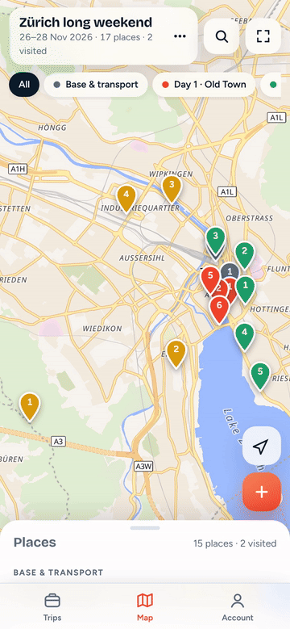 <b>Visited</b> — one tap and it leaves the map</td>
    <td align="center" width="33%"> <b>Search</b> — no need to type accents</td>
  </tr>
</table>

Video versions (MP4): <a href="docs/readme/demo-browse.mp4">explore</a> · <a href="docs/readme/demo-visited.mp4">visited</a> · <a href="docs/readme/demo-search.mp4">search</a>

## ✨ Features

<picture>
  <source media="(prefers-color-scheme: dark)" srcset="docs/readme/features-dark.png">
  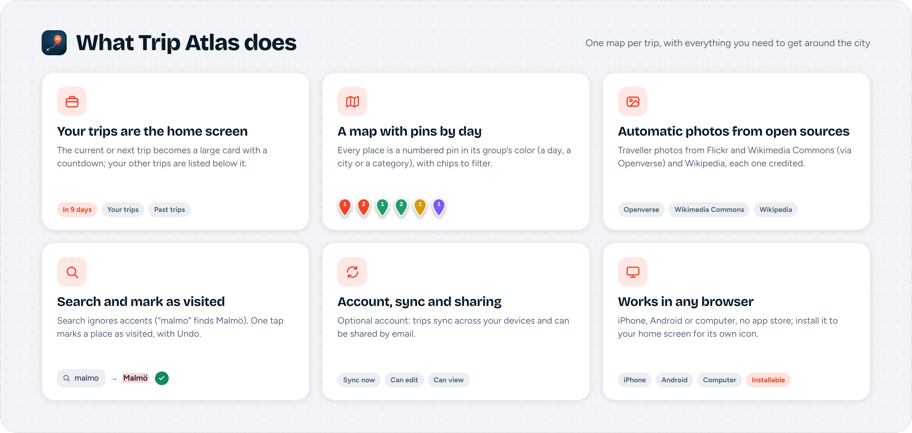
</picture>

- **🧳 Trips as the home screen** — your current or next trip gets a large card with a cover photo, a countdown ("in 9 days") and its numbers (places, groups, days, visited); then come your other trips and the ones already behind you.
- **🗺️ A map with pins by group** — [MapLibre GL](https://maplibre.org) with [OpenFreeMap](https://openfreemap.org) styles (Auto, Liberty, Bright, Light, Dark). Each group (a day, a city, a category) has its own color; **chips** at the top filter by group and the **list** below shows the same places with photo, note and distance.
- **📍 Add places** — search by name or address ([Photon](https://photon.komoot.io)), use the map center or your location, or **press and hold on the map** (right-click on a computer). Each place has a group, notes and, optionally, the title of its English Wikipedia article, which helps find the right photos.
- **📸 Automatic photos, from open sources only** — in this order:
  1. traveller photos from Flickr and Wikimedia Commons via [Openverse](https://openverse.org), searching name + city;
  2. the Wikidata image and the photos most Wikipedia languages use for the place;
  3. traveller photos under the place's other names (Wikipedia title, local-language name);
  4. the place's Wikimedia Commons category;
  5. photos taken at the spot whose file name mentions the place;
  6. photos from nearby, marked "Nearby".

  Maps, drawings, paintings, black-and-white and archive images are left out. In the full-screen viewer you can pick the **cover photo** or **hide** a photo.
- **🪧 Place card** — photos, notes, Wikipedia summary, **directions in Google Maps** (public transport) or **Apple Maps**, and opening hours.
- **🔎 Search inside a trip** — as you type, it looks through names, notes, groups and Wikipedia titles, **ignoring accents and case** ("malmo" finds Malmö). Every word must match, the matching text is highlighted and the map shows only the matching pins.
- **✅ Mark as visited** — the round tick in the list (or *Mark as visited* on the card) takes the place off the map and the list and moves it to the **Visited** chip, with day and time. You can undo right away.
- **👥 Account, sync and sharing** — name, email and password ([Supabase](https://supabase.com)). Your trips show up instantly when the app opens, **even offline**, and sync when you're back online. Invite someone by email as **Can edit** or **Can view**.
- **💾 Backup** — export one trip or all of them as JSON; import a backup or a **Google My Maps .kml**.
- **🌗 Light and dark theme**, following your system — including the map style in Auto mode.

## 📱 Where it runs and how to install

Trip Atlas is a **web app (PWA)**: it runs in any modern browser. Using it in the browser already works; installing is optional and just gives it its own icon, full screen.

| Device | Browser | Use | Install as an app (optional) |
|---|---|---|---|
| 📱 **iPhone / iPad** | Safari (or Chrome, Edge…) | ✅ | Safari › **Share** button › **Add to Home Screen**, then open it from the icon |
| 🤖 **Android** (phone and tablet) | Chrome, Edge, Samsung Internet, Firefox… | ✅ | **Install Trip Atlas** button in the **Account** tab, or Chrome › **⋮** › **Install app** (or **Add to Home screen**) |
| 💻 **Computer** (Windows, Mac, Linux, Chromebook) | Chrome, Edge, Safari, Firefox… | ✅ | Chrome/Edge › **Install** icon at the right of the address bar |

- **First visit:** two sample trips appear, *Demo trip · Paris* and *Demo trip · Rio de Janeiro*, to show how everything works. **Remove demos** in the Trips tab deletes both; they are never added to your account.
- **Same trips on every device:** create an account and sign in with it on your phone and your computer. Without an account, trips are saved on that device only. *Keep me signed in* is on by default; turn it off on a shared device.
- **On iPhone**, the Home Screen app and Safari keep separate sign-ins.
- **Location:** uses the browser's location (it asks for permission) to show where you are and the distance to each place.
- **Offline:** your trips and account stay available, but the map and photos need an internet connection.
- **On a computer:** **Esc** closes the photo viewer, the place card and the search; **← →** move between photos; right-click on the map adds a place.
- **Back button** (Android and browser) closes the top layer first: photos, form, card, search, list, and finally goes back to your trips.
- **Updating:** close the app completely and open it again (GitHub Pages can take about 10 minutes to serve a new version). The bottom of the Account tab shows the version ("Trip Atlas · updated …").

## 🖼️ Screens

<table>
  <tr>
    <td width="25%">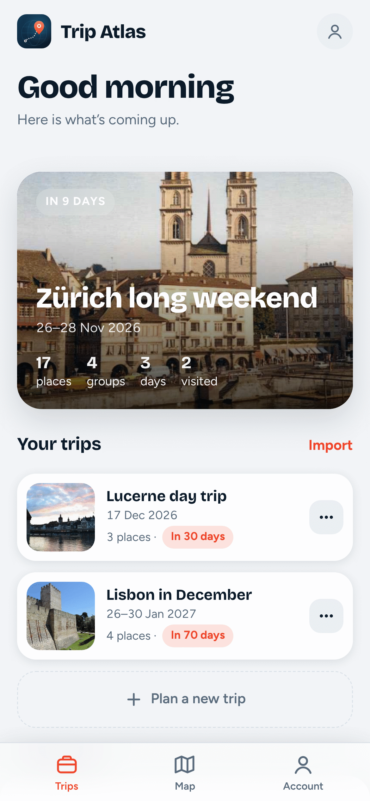</td>
    <td width="25%">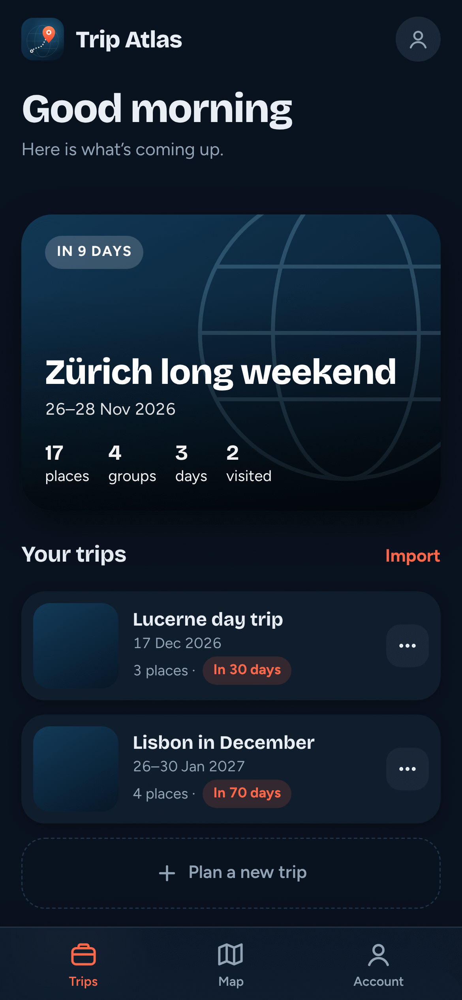</td>
    <td width="25%"></td>
    <td width="25%"></td>
  </tr>
  <tr>
    <td align="center">Trips (light)</td>
    <td align="center">Trips (dark)</td>
    <td align="center">Map (light)</td>
    <td align="center">Map (dark)</td>
  </tr>
  <tr>
    <td width="25%">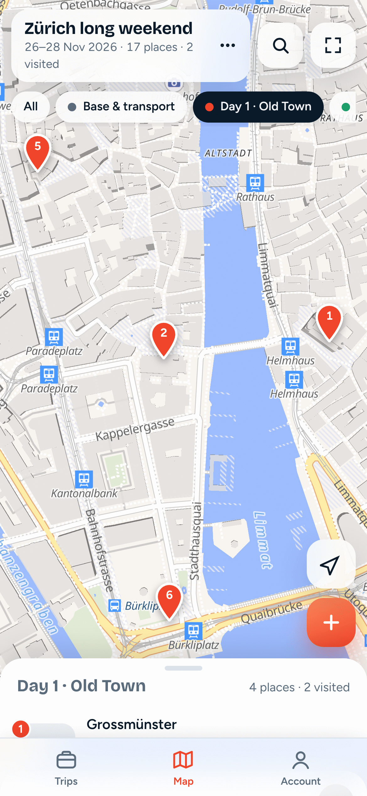</td>
    <td width="25%">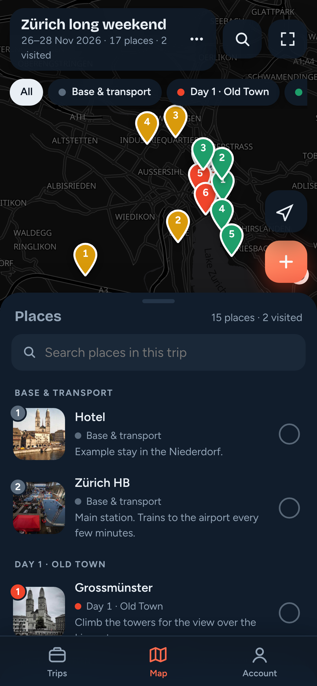</td>
    <td width="25%">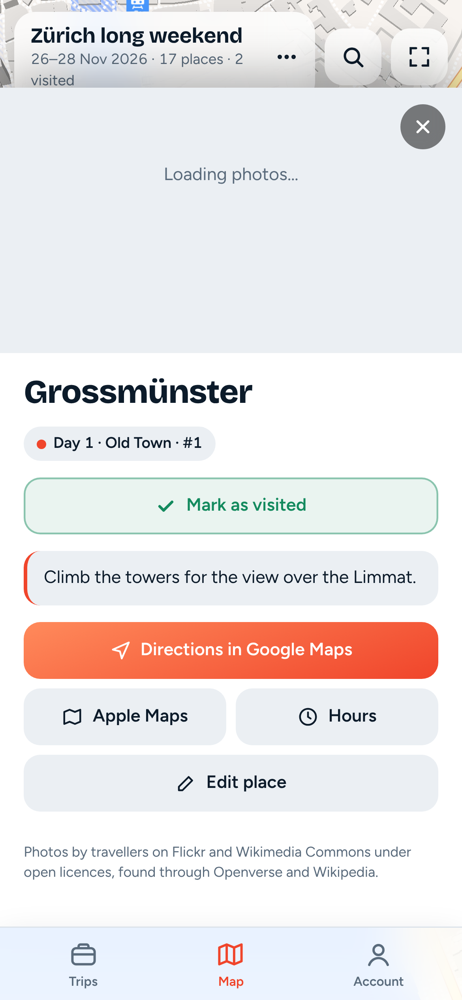</td>
    <td width="25%">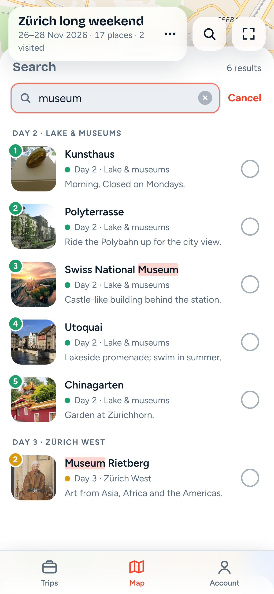</td>
  </tr>
  <tr>
    <td align="center">Filter by day</td>
    <td align="center">Places list</td>
    <td align="center">Place card</td>
    <td align="center">Search</td>
  </tr>
  <tr>
    <td width="25%">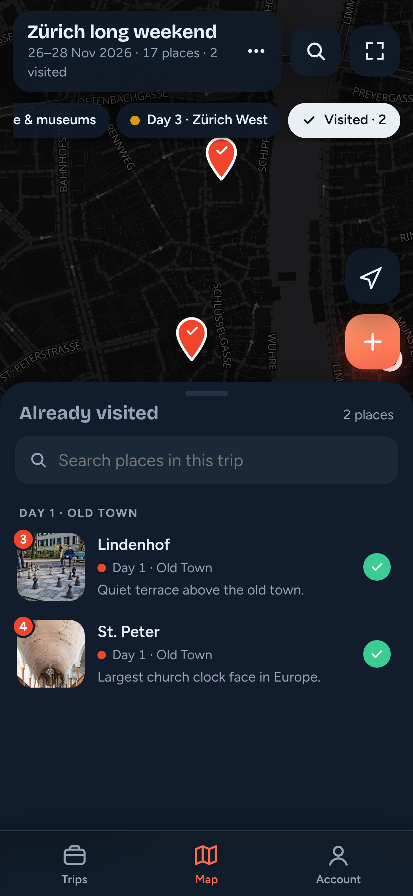</td>
    <td width="25%"></td>
    <td width="25%">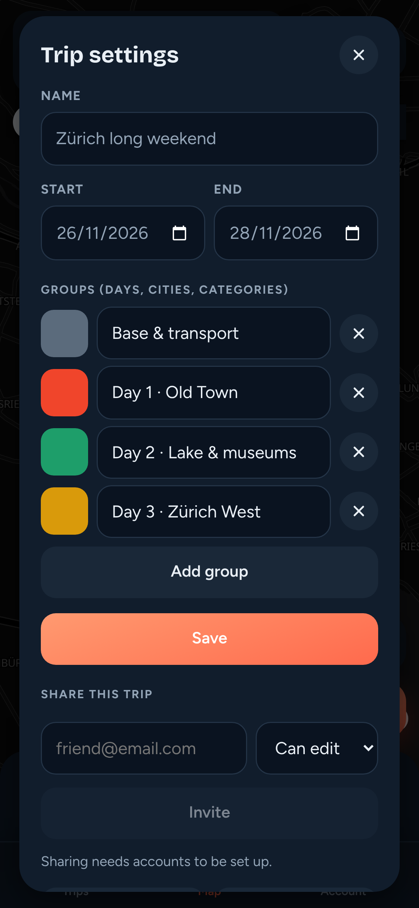</td>
    <td width="25%"></td>
  </tr>
  <tr>
    <td align="center">Visited</td>
    <td align="center">New place</td>
    <td align="center">Trip settings</td>
    <td align="center">Account</td>
  </tr>
</table>

Screenshots use a sample trip to Zürich, without an account. The photos and summaries are the ones the app found for these places.

## 🎨 Visual identity

The look starts from a **night atlas**: deep navy with the grid of a globe, a dotted route and a **coral pin** — the same drawing as the app icon. In the app, the map fills the whole screen and the controls float over it in **frosted glass**; places are **teardrop pins, numbered, with a white outline**, in their group's color. Coral marks the main actions (add, directions), green only ever means "visited", and generous rounded corners give it a native-app feel.

<picture>
  <source media="(prefers-color-scheme: dark)" srcset="docs/readme/palette-dark.png">
  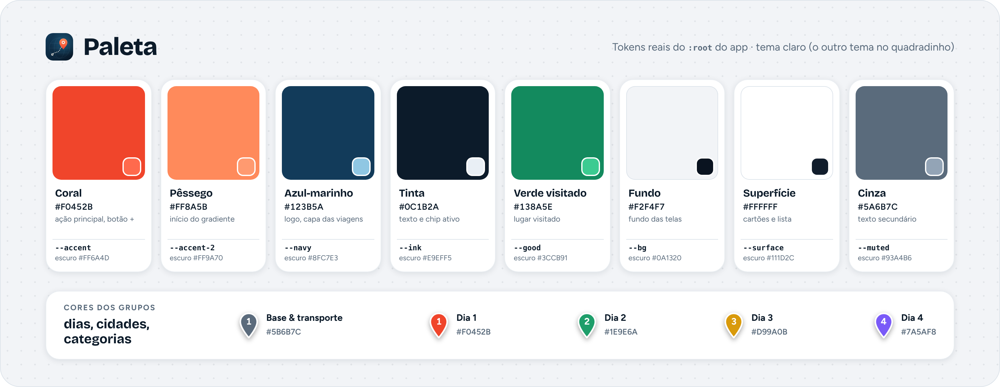
</picture>

<picture>
  <source media="(prefers-color-scheme: dark)" srcset="docs/readme/type-dark.png">
  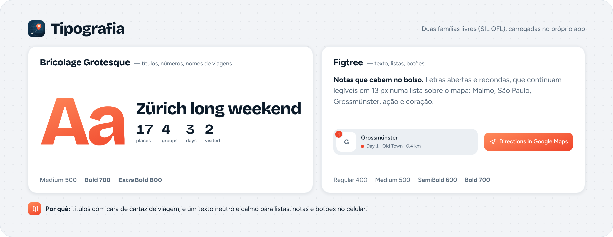
</picture>

<picture>
  <source media="(prefers-color-scheme: dark)" srcset="docs/readme/components-dark.png">
  
</picture>

## 🛠️ Under the hood

- **One file:** `index.html` holds the whole app — HTML, CSS and plain JavaScript, no framework and no build step. Libraries come from jsDelivr: **MapLibre GL 4.7.1** and **supabase-js 2.49.4**.
- **Files:**
  - `config.js` — the Supabase project URL and its public (anon) key. Leave both empty to use the app without accounts (trips stay on the device).
  - `setup.sql` — creates the `trips` table with row-level security (RLS): each user can only read and write their own trips.
  - `sharing.sql` — sharing: the `trip_shares` table, the `trip_role()` function (owner, editor or viewer) and policies where the owner can do everything, editors can update and viewers can only read; a trigger keeps an editor from taking ownership.
  - `manifest.webmanifest`, `icon*.png`, `logo.svg` — name, colors and icons of the installed app (the *maskable* icon adapts to Android's shapes).
  - `sw.js` — a service worker that **caches nothing**: it exists only because Chrome needs one to offer installation, so every launch loads the newest version.
  - `PROMPTS.md` — the conversation that built the app.
- **Local data:** trips live in `localStorage` (`atlas.v2.guest` without an account, `atlas.v2.<user>` with one) and the photos and summaries found are cached (`atlas.info.v6`). With an account, changes go up to Supabase and sync whenever there's a connection.
- **External services, all free:** OpenFreeMap (map), Photon by Komoot (address search and each place's city), Openverse (up to 20 results per search without an API key), the Wikipedia, Wikidata and Wikimedia Commons APIs (photos and summaries), and Google Maps and Apple Maps links for directions.
- **Platform details:** in iOS 26 Home Screen apps the page can end above the bottom edge; the app measures this on open and stretches the map, panels and tab bar to the edge (iPhone and iPad only). On Android, panels use `dvh` units to fit the visible area.

**Run it locally:** serve the folder with any static server, e.g. `python3 -m http.server`, and open `http://localhost:8000`.

**Set up accounts (optional):** create a Supabase project, run `setup.sql` and then `sharing.sql` in the SQL Editor, put the URL and the public key in `config.js` and, under Authentication, turn off *Confirm email* and set the Site URL and Redirect URLs to the app's address (so password-reset links work).

## 🤖 Built with AI (vibe-coded)

This app was built by describing what I wanted in plain language to **Claude**, Anthropic's AI assistant, which wrote the code, the SQL, the logo and the setup steps. I tested it mainly on iPhone and steered development with feedback, but I didn't write the code by hand. There may be rough edges; review the code before reusing it. The full conversation, prompts and answers, is in [PROMPTS.md](PROMPTS.md).

## 🙏 Credits

- Map data: © [OpenStreetMap contributors](https://www.openstreetmap.org/copyright) (ODbL), using the [OpenMapTiles](https://openmaptiles.org) schema; maps served by [OpenFreeMap](https://openfreemap.org).
- Interactive map: [MapLibre GL JS](https://maplibre.org) (BSD-3-Clause licence).
- Address search: [Photon](https://photon.komoot.io), by Komoot.
- Photos: authors on Flickr and Wikimedia Commons, under open licences, found via [Openverse](https://openverse.org) and Wikimedia; every photo shows its credit and a link to the original. Summaries from [Wikipedia](https://www.wikipedia.org) (CC BY-SA). The photos in this README's screenshots and demos were found by the app the same way.
- Accounts and database: [Supabase](https://supabase.com).
- Fonts: [Bricolage Grotesque](https://fonts.google.com/specimen/Bricolage+Grotesque) and [Figtree](https://fonts.google.com/specimen/Figtree) (SIL Open Font License).
- Made by **Lucas Ayub**, with help from Claude (Anthropic).
